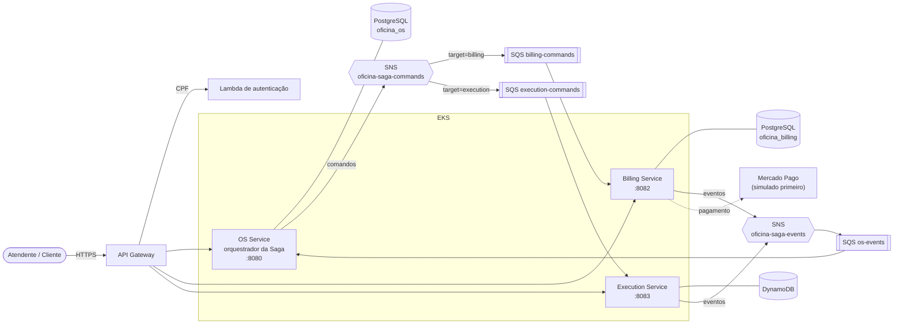
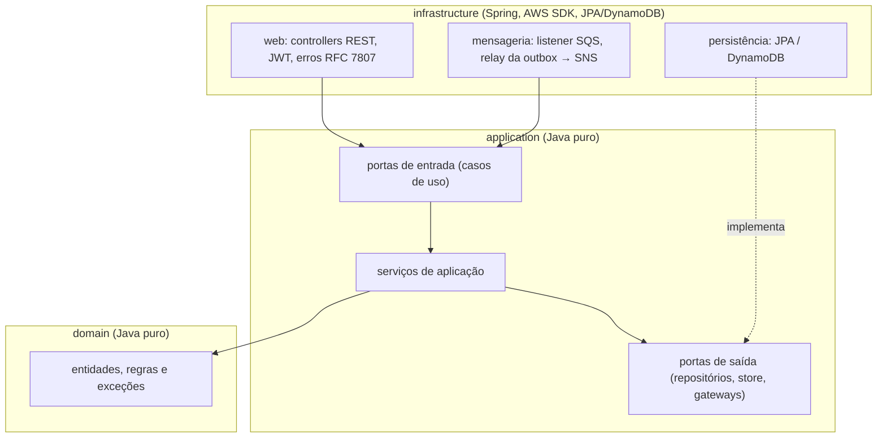

# Arquitetura

> Documento vivo. As partes **implementadas** descrevem o que existe no código; o que ainda depende do deploy final na AWS está indicado no texto.
> Decisões e justificativas completas: [`adr/`](adr/). Mensagens e compensações: [`eventos.md`](eventos.md).

## 1. Visão geral

> Modelagem de domínio (contextos, agregados, estados e linguagem ubíqua): [`ddd.md`](ddd.md). Event Storming: [`event-storming.md`](event-storming.md).

Três microsserviços independentes (repositório, pipeline, banco e implantação próprios), conversando por **REST** (usuário → serviço)
e por **mensageria assíncrona** (serviço ↔ serviço), coordenados por uma **Saga orquestrada**.

| Serviço | Responsabilidade | Banco | Porta local |
|---|---|---|---|
| OS Service | clientes, veículos, catálogo, ciclo de vida da OS, **orquestrador da Saga** | PostgreSQL (SQL) | 8080 |
| Billing Service | orçamento, pagamento, estorno | PostgreSQL (SQL) | 8082 |
| Execution Service | fila de execução, estoque de peças, reservas | DynamoDB (NoSQL) | 8083 |

Regra de isolamento: **nenhum serviço lê o banco do outro**. Só trocam mensagens e chamadas REST.

## 2. Estilo interno: arquitetura hexagonal

Cada serviço tem as mesmas três camadas, com dependência apontando sempre para dentro:

- `domain` e `application` não conhecem Spring nem AWS: testam-se com JUnit puro e rápido.
- `infrastructure` implementa as portas de saída (ex.: `ExecucaoStore` sobre `TransactWriteItems` do DynamoDB) e expõe as de entrada.
- Efeito prático: trocar o gateway de pagamento simulado pelo Mercado Pago real é um novo adaptador, sem tocar nas regras.

## 3. Dados e consistência

| Serviço | Modelo | Garantias |
|---|---|---|
| OS / Billing | PostgreSQL + Flyway (esquema só por migração; Hibernate apenas valida) | transação ACID por caso de uso |
| Execution | DynamoDB: `estoque`, `execucao` (GSI por status), `mensagem_processada` (TTL), `outbox` (GSI esparso de pendentes) | **uma `TransactWriteItems` por comando**: baixa de estoque com condição `disponivel >= qtd`, execução com versão otimista, marca de mensagem processada e eventos juntos ([ADR-006](adr/006-execution-dynamodb-transacoes-e-outbox.md)) |

**Outbox transacional** em todos os serviços: o estado e o evento a publicar são gravados juntos; um *relay* os envia ao SNS depois, em ordem.
Isso evita o clássico "gravei no banco mas a mensagem se perdeu". A entrega é *at-least-once*, então todo consumidor é **idempotente**
(descarta repetição pelo `messageId` e pela regra de negócio).

## 4. Saga orquestrada

O OS Service é o orquestrador: guarda o estado da Saga, envia comandos e reage aos eventos. Quando um passo falha, dispara as
**compensações em ordem inversa** (liberar estoque → estornar pagamento → cancelar orçamento). Fluxo feliz, compensações A/B/C e a
matriz "falha por etapa" estão em [`eventos.md`](eventos.md); a justificativa da escolha (orquestração em vez de coreografia) está no
[ADR-002](adr/002-saga-orquestrada.md).

Pontos principais:
- Um `sagaId` por OS e um `correlationId` que atravessa REST, mensagens e logs.
- Novo status `CANCELADA` para OS compensada.
- Mensagem inválida nunca é confirmada: após 3 tentativas vai para a **DLQ** (`*-dlq`), onde a operação a analisa.

## 5. Mensageria

SNS + SQS ([ADR-003](adr/003-mensageria-sns-sqs.md)):
- `oficina-saga-commands` (tópico) com **filtro por atributo `target`** → filas `billing-commands` e `execution-commands`.
- `oficina-saga-events` (tópico) → fila `os-events`.
- Cada fila com DLQ (`maxReceiveCount = 3`). Envelope comum: `messageId`, `sagaId`, `osId`, `type`, `version`, `occurredAt`, `correlationId`, `payload`.
- Consumidor: *long polling* em thread própria; a mensagem só é apagada depois de tratada com sucesso.

## 6. Segurança

- API protegida por **JWT HS256** (segredo compartilhado, vindo de Secret do Kubernetes; nunca no Git). O OS Service emite; Billing e Execution validam.
- Autenticação do cliente por **CPF** via Lambda atrás do API Gateway (`POST /auth/cpf`): a Lambda valida o CPF, consulta o OS Service com um token de serviço e devolve um JWT com papel `CLIENTE` ([ADR-007](adr/007-autenticacao-cpf-lambda.md)).
- Credenciais do Mercado Pago e da AWS apenas em Secrets/variáveis de ambiente de CI.

## 7. Observabilidade

- Implementado: `correlationId` e `sagaId` no MDC dos logs; `/actuator/health` com sondas *liveness/readiness*.
- **New Relic (plano gratuito):** o agente Java vai dentro da imagem de cada serviço e só é ligado quando existe o segredo `newrelic` (`NEW_RELIC_LICENSE_KEY`) no cluster. Tracing distribuído e encaminhamento de logs ativos por variáveis do ConfigMap. Painel (latência, erros, throughput por serviço): a montar no dia do deploy real.

## 8. Implantação e CI/CD

Ensaio completo do Terraform e do deploy feito em 25–26/10; o deploy final acontece perto da gravação do vídeo (a infraestrutura custa por hora e é destruída logo depois).

- **Local:** `docker-compose` (2 Postgres + LocalStack com SNS, SQS e DynamoDB) — [ADR-005](adr/005-ambiente-local-localstack.md).
- **AWS:** Terraform → EKS, API Gateway, Lambda, SNS/SQS, RDS PostgreSQL ×2, DynamoDB. Cada serviço tem `Dockerfile` e manifestos `k8s/`.
- **Pipeline por serviço (GitHub Actions):** build → testes + cobertura (JaCoCo, mínimo 80%) → SonarQube Cloud → imagem → deploy no EKS. `main` protegida, merge só por PR.

## 9. Qualidade

- Cobertura mínima de 80% por serviço, **imposta no build** (JaCoCo): OS Service 94,9%, Billing 90,5% e Execution 93,1% de linhas (evidências em [`cobertura.md`](cobertura.md)).
- Testes de integração com **Testcontainers** (Postgres e LocalStack reais), sem mocks de banco.
- Scripts ponta a ponta contra o LocalStack: `scripts/local/billing-e2e.sh`, `execution-e2e.sh`.
- BDD (Cucumber) do fluxo completo da Saga, com compensação, no OS Service: `src/test/resources/features/saga_ordem_servico.feature`.
- Scripts ponta a ponta: `scripts/local/saga-e2e.ps1` (4 cenários da Saga) e `auth-cpf-e2e.ps1` (login por CPF e papéis).

## 10. Trade-offs assumidos

| Decisão | Ganho | Custo aceito |
|---|---|---|
| Orquestração central | fluxo legível, auditável, compensação em ordem | OS Service concentra a lógica da Saga |
| Outbox + at-least-once | nenhuma mensagem perdida | consumidores precisam ser idempotentes |
| DynamoDB no Execution | transação no estoque sem servidor de banco, escala simples | consultas só pelos índices modelados |
| Segredo JWT compartilhado | simplicidade para o prazo | rotação manual; em produção real usaria chave assimétrica |
| Pagamento simulado primeiro | desenvolver e testar sem conta externa | adaptador real do Mercado Pago entra depois, atrás da mesma porta |
