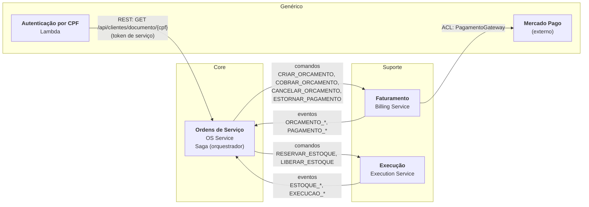
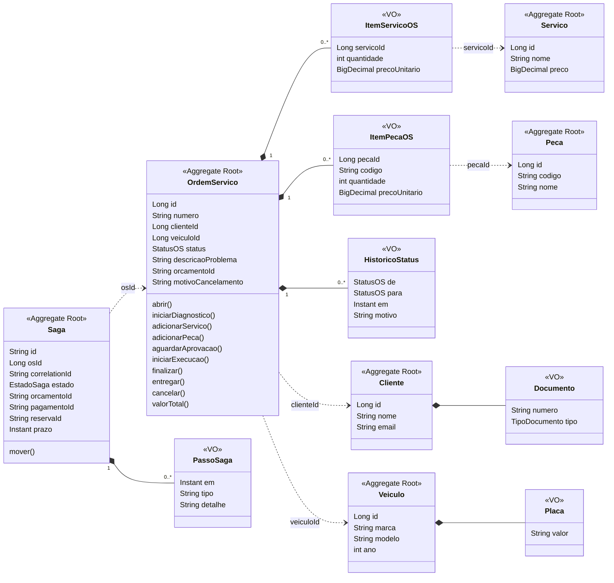
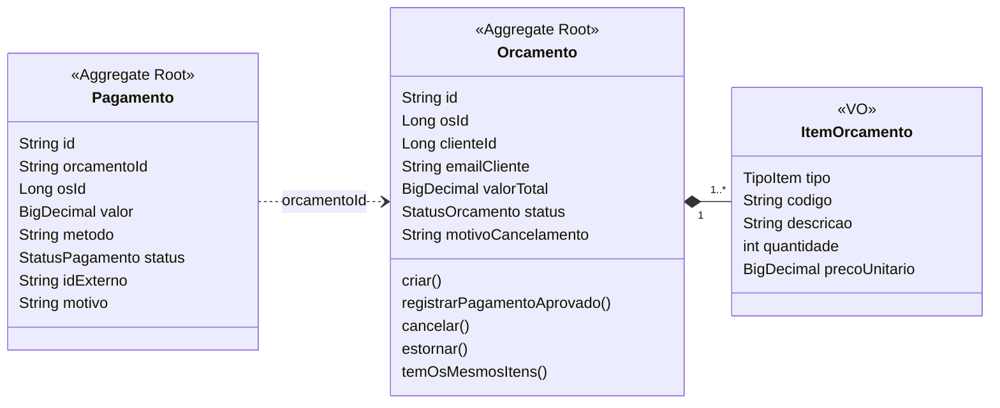
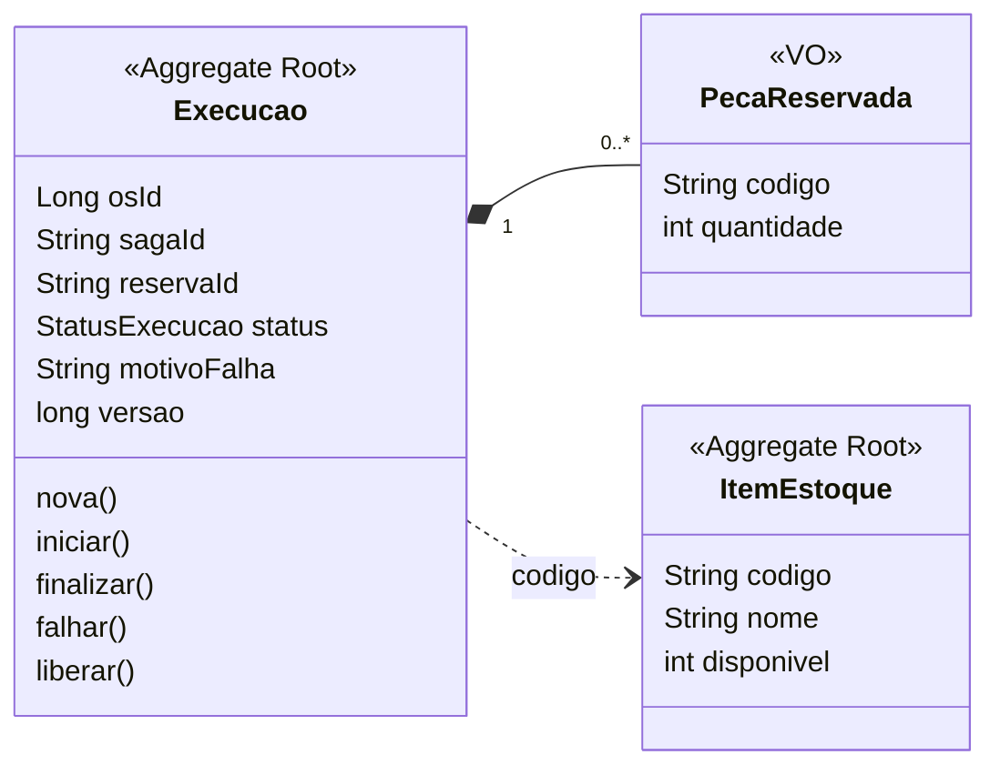
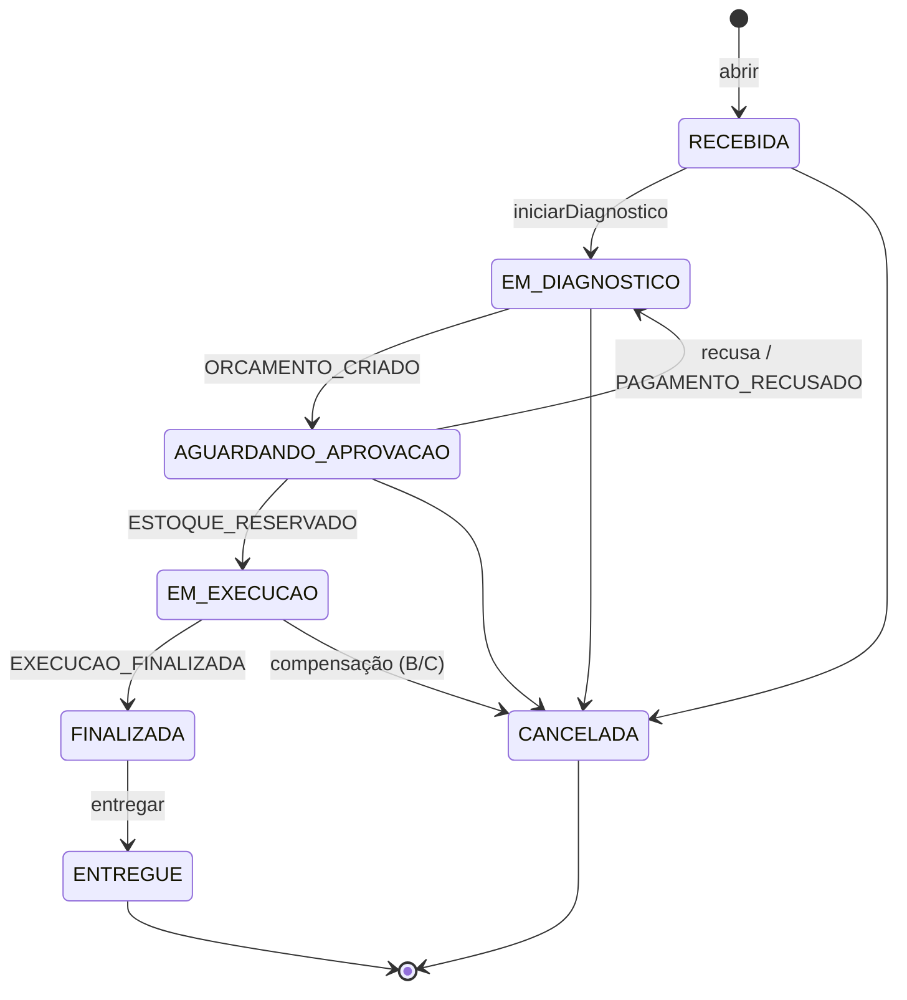
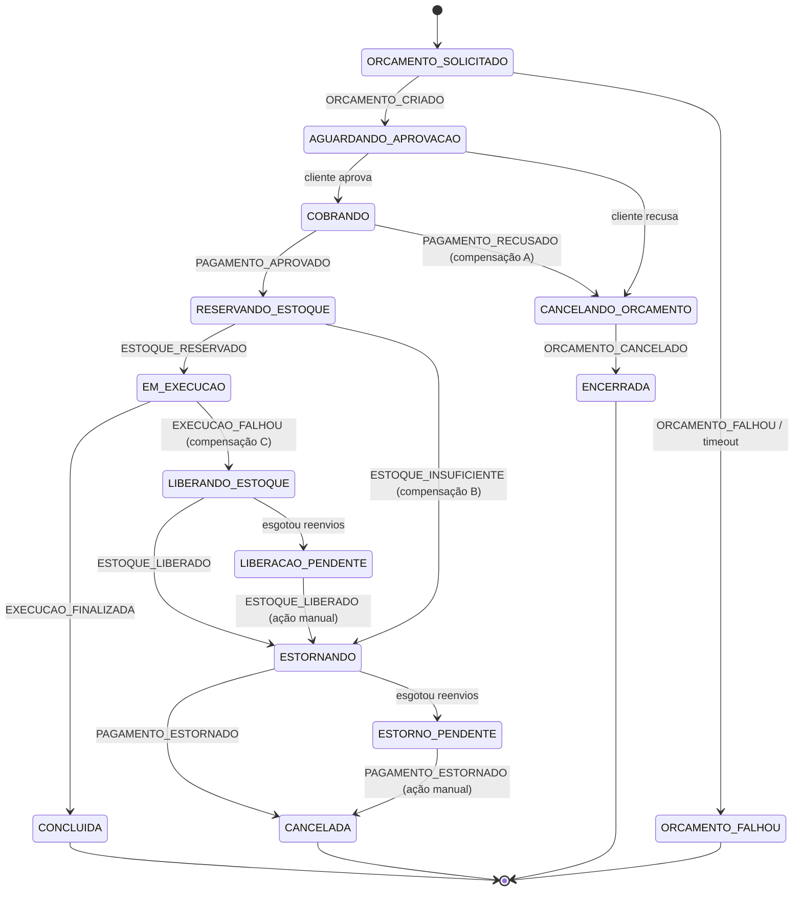
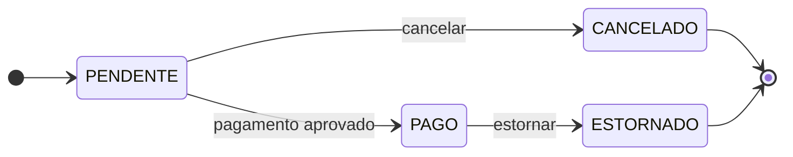
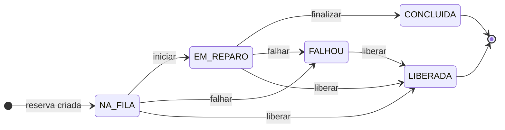
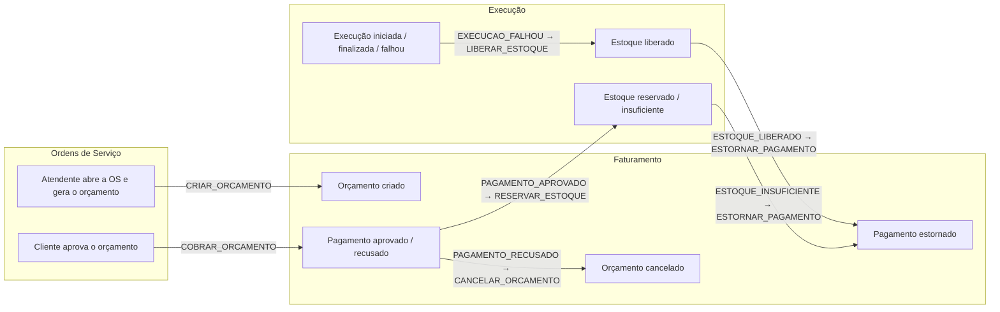

# Modelagem de domínio (DDD)

> Os diagramas abaixo descrevem o que existe no código (pacotes `domain` de cada serviço) e o contrato de
> [`eventos.md`](eventos.md). Os limites dos contextos estão justificados no [ADR-001](adr/001-microsservicos-e-limites.md).

> Imagens prontas para o PDF de entrega: [`diagramas/ddd/`](diagramas/ddd/) (um PNG por diagrama).

## 1. Subdomínios e contextos delimitados

| Subdomínio | Tipo | Contexto delimitado (serviço) | Por quê |
|---|---|---|---|
| Gestão da ordem de serviço e coordenação do fluxo | **Core** | **Ordens de Serviço** (OS Service) | É o que diferencia a oficina: ciclo da OS, orçamento, aprovação e a Saga que garante consistência entre contextos |
| Cobrança | Suporte | **Faturamento** (Billing Service) | Regra própria (orçamento, pagamento, estorno), mas sem diferencial competitivo |
| Execução e estoque | Suporte | **Execução** (Execution Service) | Fila de trabalho e reserva de peças; ritmo e banco diferentes (NoSQL) |
| Processamento de pagamento | Genérico | Mercado Pago (externo, atrás de um adaptador) | Comprado pronto; o domínio não depende dele |
| Autenticação por CPF | Genérico | Lambda de autenticação | Papel técnico; não tem regra de negócio própria |

Cada contexto tem **banco próprio** e nenhum lê o banco do outro. O mesmo conceito aparece com significado diferente em cada lado
(a "OS" do Faturamento é só um `osId` ligado a um orçamento; no Execution é uma fila de peças e serviços).

## 2. Mapa de contextos (context map)

| Relação | Padrão de integração (DDD) | Como aparece no código |
|---|---|---|
| OS Service → Billing / Execution | **Customer/Supplier** com **Published Language** | O OS Service define o envelope e os comandos ([`eventos.md`](eventos.md)); os serviços de apoio se adaptam a ele. Mensagens versionadas (`version`) |
| Billing / Execution → OS Service | **Published Language** (eventos) | Eventos no mesmo envelope, via SNS/SQS; o orquestrador só reage a eles |
| Billing → Mercado Pago | **Anti-Corruption Layer** | Porta `PagamentoGateway`; o adaptador traduz o modelo do Mercado Pago (hoje simulado) para `Pagamento` sem vazar nada no domínio |
| Lambda → OS Service | **Open Host Service** (REST) + cliente conforme | O OS Service expõe a consulta por documento; a Lambda a usa como está e valida o CPF antes |
| Billing ↔ Execution | **Nenhuma** (separate ways) | Não se conhecem; só falam com o orquestrador |

## 3. Agregados por contexto

Em negrito, a raiz do agregado. Objetos de valor (VO) são imutáveis e comparados pelo valor.

### 3.1 Ordens de Serviço (OS Service)

Regras que o agregado protege (invariantes): a OS só muda de status por transições válidas; só gera orçamento com itens; o valor total
é a soma dos itens; CPF/CNPJ e placa são validados na criação do objeto de valor. Os agregados se referenciam **só por id**
(setas tracejadas). A `Saga` é um agregado separado da OS porque tem ciclo de vida e consistência próprios (timeouts, reenvios).

### 3.2 Faturamento (Billing Service)

Invariantes: só um orçamento pendente pode receber pagamento ou ser cancelado; só um orçamento pago pode ser estornado; um orçamento
pago **não** pode ser cancelado, tem que ser estornado; repetir `cancelar` não faz nada (idempotência).

### 3.3 Execução (Execution Service)

Invariantes: a baixa de estoque só acontece se `disponivel >= quantidade` (condição na `TransactWriteItems` do DynamoDB); uma execução
concluída **não** pode ser liberada (as peças foram usadas); `liberar` repetido não faz nada; a `versao` evita escrita concorrente.
O estoque e a execução são agregados distintos, mas alterados na mesma transação do DynamoDB ([ADR-006](adr/006-execution-dynamodb-transacoes-e-outbox.md)).

## 4. Ciclos de vida (estados dos agregados)

### 4.1 Ordem de Serviço

### 4.2 Saga (orquestrada pelo OS Service)

Estados `*_PENDENTE` sinalizam que a compensação não terminou sozinha e **precisa de ação humana** (a mensagem foi para a DLQ).

### 4.3 Orçamento e Execução

## 5. Comandos e eventos de domínio

Quem **decide** (comando) e quem **informa o que aconteceu** (evento). O orquestrador é o único que envia comandos.

A tabela completa (payloads e reação do orquestrador) está em [`eventos.md`](eventos.md).

## 6. Linguagem ubíqua (glossário)

| Termo | Significado no domínio |
|---|---|
| **Ordem de Serviço (OS)** | Pedido de reparo de um veículo de um cliente, com serviços e peças; vive no contexto Ordens de Serviço |
| **Orçamento** | Proposta de valor de uma OS; vive no Faturamento. Pode ser pendente, pago, cancelado ou estornado |
| **Aprovação** | Decisão do cliente de aceitar o orçamento; dispara a cobrança |
| **Pagamento / Estorno** | Cobrança do orçamento e devolução do valor quando a OS é compensada |
| **Reserva de estoque** | Peças separadas para uma OS; só existe no contexto Execução |
| **Execução** | Trabalho da oficina sobre uma OS (na fila, em reparo, concluída, falhou, liberada) |
| **Saga** | Fluxo distribuído que une cobrança, reserva e execução, com **compensações** quando um passo falha |
| **Compensação** | Ação que desfaz um passo já feito (cancelar orçamento, estornar pagamento, liberar estoque) |
| **Comando** | Pedido do orquestrador para um serviço fazer algo (`COBRAR_ORCAMENTO`) |
| **Evento** | Fato que já aconteceu, publicado por um serviço (`PAGAMENTO_APROVADO`) |
| **Outbox** | Tabela em que o evento é gravado junto com o estado; um *relay* o envia depois, para nada se perder |
| **Idempotência** | Processar a mesma mensagem duas vezes tem o mesmo efeito de processar uma |
| **DLQ** | Fila de mensagens que falharam 3 vezes; exige análise humana |

## 7. Como isso aparece no código

| Conceito DDD | Onde |
|---|---|
| Agregados, objetos de valor, regras | `domain/model` de cada serviço, em Java puro |
| Exceções de negócio | `domain/exception` |
| Casos de uso (serviços de aplicação) e portas | `application/service`, `application/port/in`, `application/port/out` |
| Repositórios, mensageria, REST, ACL | `infrastructure/*` (adaptadores das portas) |
| Orquestrador da Saga | `OrquestradorSaga` (OS Service) |
