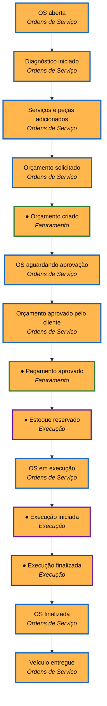
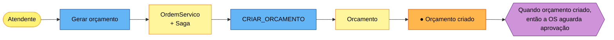
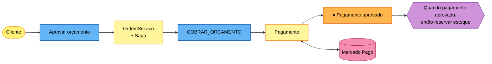
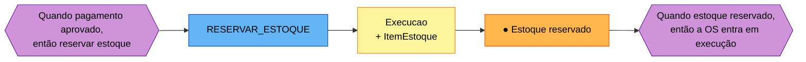
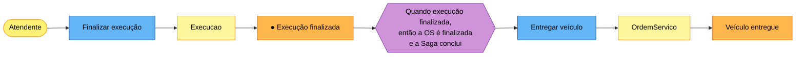
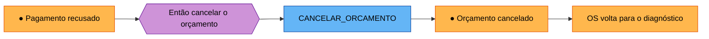
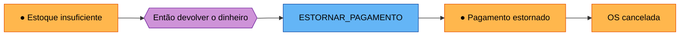

# Event Storming

> Este documento é a **reconstrução do Event Storming** do domínio da oficina a partir do que foi implementado e documentado
> ([`eventos.md`](eventos.md), [`ddd.md`](ddd.md)). Não é o registro de uma oficina presencial com post-its: é o resultado dela,
> organizado nos três níveis do método (*big picture*, *process level* e *design level*). Os eventos aqui são os mesmos do código.

> Imagens prontas para o PDF: [`diagramas/event-storming/`](diagramas/event-storming/).

## Legenda (cores dos post-its)

| Cor | Elemento | Como ler |
|---|---|---|
| 🟧 laranja | **Evento de domínio** | Algo que já aconteceu, no passado (ex.: *Pagamento aprovado*) |
| 🟦 azul | **Comando** | Intenção de fazer algo (ex.: *Cobrar orçamento*) |
| 🟨 amarelo pequeno | **Ator** | Quem dispara o comando (atendente, cliente) |
| 🟡 amarelo grande | **Agregado** | Quem recebe o comando, aplica as regras e gera o evento |
| 🟪 lilás | **Política** | Regra do tipo "**quando** acontecer X, **então** fazer Y" |
| 🌸 rosa | **Sistema externo** | Mercado Pago |
| 🟥 vermelho | **Ponto de atenção** (*hotspot*) | Dúvida, risco ou decisão adiada |

Os eventos marcados com `●` trafegam como **mensagem** entre serviços (contrato em [`eventos.md`](eventos.md)). Os demais acontecem dentro do
OS Service e ficam registrados no histórico da OS (`os_historico`).

## 1. Big picture: linha do tempo dos eventos

De cima para baixo, na ordem em que acontecem no caminho feliz. A cor da borda indica o contexto que gera o evento.

Borda azul: Ordens de Serviço · verde: Faturamento · roxa: Execução.

Eventos do caminho infeliz (todos publicados como mensagem): *Orçamento falhou*, *Pagamento recusado*, *Orçamento cancelado*, *Estoque insuficiente*,
*Execução falhou*, *Estoque liberado*, *Pagamento estornado*.

## 2. Process level: caminho feliz

Cada passo segue o padrão **ator → comando → agregado → evento → política → próximo comando**. O caminho feliz tem quatro passos.

### Passo 1: gerar o orçamento

### Passo 2: aprovar e cobrar

### Passo 3: reservar o estoque

### Passo 4: executar e entregar

As **políticas** em lilás são exatamente o que o `OrquestradorSaga` implementa: ele não executa regra de negócio dos outros contextos, só reage a eventos e
decide o próximo comando.

## 3. Process level: o que acontece quando algo falha (compensações)

### A) Pagamento recusado

### B) Estoque insuficiente (o cliente já pagou)

### C) Falha na execução

Regra de ordem: **a compensação desfaz os passos na ordem inversa** (libera o estoque antes de estornar). Políticas adicionais do orquestrador:

| Quando | Então |
|---|---|
| Um comando fica sem resposta além do prazo (`SAGA_PRAZO_RESPOSTA_SEGUNDOS`) | reenvia, até `SAGA_MAX_REENVIOS` vezes |
| Os reenvios acabam durante o pedido de orçamento | encerra a Saga como `ORCAMENTO_FALHOU` (nada a desfazer) |
| Os reenvios acabam durante a compensação | marca `ESTORNO_PENDENTE` ou `LIBERACAO_PENDENTE` e a operação age manualmente |
| Uma mensagem falha 3 vezes no consumidor | vai para a DLQ |
| Chega uma mensagem repetida | descarta pelo `messageId` (idempotência) |

## 4. Design level: agregados, comandos e eventos por contexto

| Contexto | Agregado | Comandos que recebe | Eventos que gera |
|---|---|---|---|
| Ordens de Serviço | `OrdemServico` | abrir, iniciar diagnóstico, adicionar serviço/peça, aprovar, recusar, cancelar, entregar | OS aberta, diagnóstico iniciado, orçamento aprovado/recusado, OS cancelada, veículo entregue |
| Ordens de Serviço | `Saga` | (reage aos eventos dos outros contextos) | muda de estado e emite comandos (via outbox) |
| Faturamento | `Orcamento` | `CRIAR_ORCAMENTO`, `CANCELAR_ORCAMENTO` | ● orçamento criado, falhou, cancelado |
| Faturamento | `Pagamento` | `COBRAR_ORCAMENTO`, `ESTORNAR_PAGAMENTO` | ● pagamento aprovado, recusado, estornado |
| Execução | `Execucao` + `ItemEstoque` | `RESERVAR_ESTOQUE`, `LIBERAR_ESTOQUE`, iniciar, finalizar, falhar | ● estoque reservado, insuficiente, liberado; ● execução iniciada, finalizada, falhou |

Estados de cada agregado: [`ddd.md`](ddd.md), seção 4.

## 5. Pontos de atenção (*hotspots*)

| Ponto | Situação | Decisão |
|---|---|---|
| 🟥 Cobrança na retirada do veículo | Hoje o cliente paga na aprovação, antes de reservar estoque. Pagar só na entrega muda a ordem da Saga e o sentido das compensações (o conserto não se desfaz) | **Adiado.** Registrado como evolução futura; fluxo atual mantido |
| 🟥 Aviso ao cliente (e-mail/SMS) | Hoje ninguém avisa o cliente: o e-mail só segue no comando `CRIAR_ORCAMENTO` e é usado como pagador no gateway. O cliente consulta `GET /api/minhas-ordens` | **Adiado.** Evolução futura: um consumidor dos eventos da Saga já existentes (orçamento pronto, pago, finalizado, cancelada), via SNS direto para e-mail ou um serviço de notificações com SES; não altera o domínio nem as compensações |
| 🟥 Estorno que não conclui | O Mercado Pago pode falhar ao estornar | Reenvia e, esgotadas as tentativas, a Saga fica em `ESTORNO_PENDENTE` para ação manual (DLQ + alerta) |
| 🟥 Estoque liberado que não conclui | Falha ao devolver as peças | Fica em `LIBERACAO_PENDENTE`; ação manual |
| 🟥 Mercado Pago real | Hoje o adaptador é simulado (`APRO`, `FUND`, `OTHE`, `ERRO`, `ERRO_ESTORNO`) | A integração real é um novo adaptador da porta `PagamentoGateway`, sem mudar o domínio |
| 🟥 Mensagem duplicada | A entrega é *at-least-once* | Todo consumidor é idempotente (`messageId` + regra de negócio) |
| 🟥 Cliente recusa o orçamento | Não há pagamento a desfazer | Saga cancela o orçamento e a OS volta para o diagnóstico |
