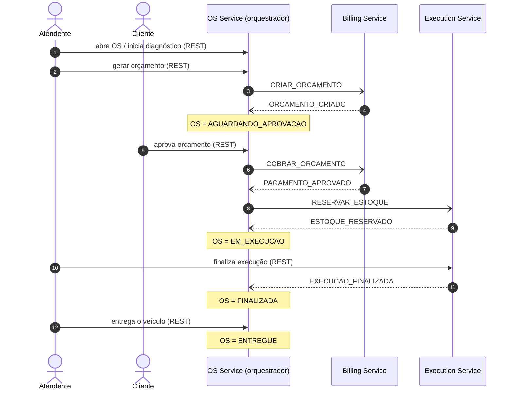
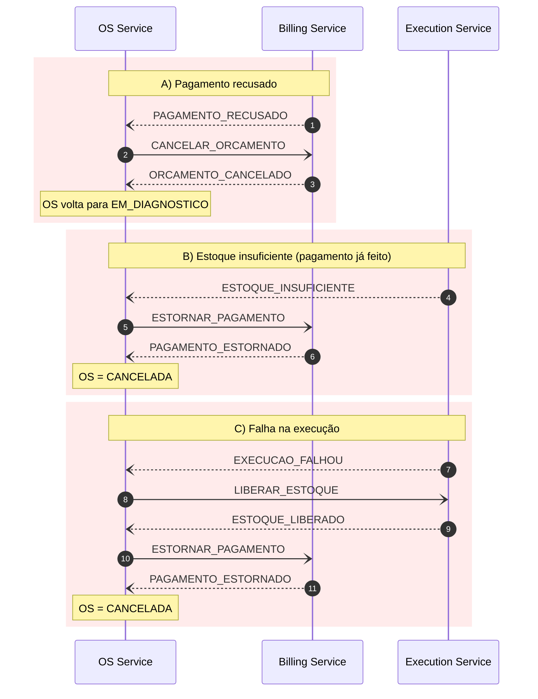

# Contrato de mensagens da Saga

Este documento é o contrato entre os três serviços. Mudou aqui, muda nos três.

## Topologia

```
                 oficina-saga-commands (SNS)                oficina-saga-events (SNS)
 OS Service ───────────────┬──────────────┐        ┌──────────── Billing Service
 (orquestrador)            │ target=billing│        │ ┌────────── Execution Service
        ▲                  ▼              ▼         │ │
        │         billing-commands   execution-commands
        │            (SQS + DLQ)       (SQS + DLQ)  │ │
        │                                           ▼ ▼
        └──────────────────────────────────── os-events (SQS + DLQ)
```

| Recurso | Tipo | Quem publica | Quem consome |
|---|---|---|---|
| `oficina-saga-commands` | SNS | OS Service | — (fan-out com filtro) |
| `billing-commands` | SQS | assinatura `target=billing` | Billing Service |
| `execution-commands` | SQS | assinatura `target=execution` | Execution Service |
| `oficina-saga-events` | SNS | Billing, Execution | — |
| `os-events` | SQS | assinatura (todos os eventos) | OS Service |
| `*-dlq` | SQS | redrive após 3 tentativas | operação (reprocessamento manual) |

Filas **standard** (não FIFO), entrega *at-least-once*. Cada fila usa `RawMessageDelivery`:
o corpo da mensagem é exatamente o envelope abaixo.

## Envelope

```json
{
  "messageId": "b6f0c2a4-0d0f-4b1e-9f43-6c1d6a0e1a11",
  "sagaId":    "3f1c9d52-5c89-4c8e-8a53-1d4f9b7e2a90",
  "osId":      42,
  "type":      "CRIAR_ORCAMENTO",
  "version":   1,
  "occurredAt":"2026-11-03T14:05:00Z",
  "correlationId": "req-7d2e...",
  "payload":   { }
}
```

| Campo | Regra |
|---|---|
| `messageId` | UUID único por mensagem. Consumidores guardam os já processados (idempotência). |
| `sagaId` | UUID da instância da Saga; igual em todas as mensagens daquele fluxo. |
| `osId` | Identificador da OS no OS Service. |
| `type` | Nome do comando ou evento (tabelas abaixo). |
| `version` | Versão do schema do payload. Começa em 1. |
| `occurredAt` | ISO-8601 em UTC. |
| `correlationId` | Vem do cabeçalho HTTP `X-Correlation-Id` da requisição original; vai nos logs e no New Relic. |

Atributos de mensagem SNS (usados para roteamento, não fazem parte do corpo):
`type` (sempre) e `target` (só em comandos: `billing` ou `execution`).

## Comandos (OS Service → serviços)

| `type` | `target` | Payload | Efeito |
|---|---|---|---|
| `CRIAR_ORCAMENTO` | billing | `itens[]` (`tipo` SERVICO/PECA, `codigo`, `descricao`, `quantidade`, `precoUnitario`), `valorTotal`, `clienteId`, `emailCliente` | Cria o orçamento (PENDENTE). |
| `COBRAR_ORCAMENTO` | billing | `orcamentoId`, `valorTotal`, `metodo` | Inicia o pagamento. |
| `CANCELAR_ORCAMENTO` | billing | `orcamentoId`, `motivo` | Cancela o orçamento (compensação). |
| `ESTORNAR_PAGAMENTO` | billing | `pagamentoId`, `motivo` | Estorna o pagamento (compensação). |
| `RESERVAR_ESTOQUE` | execution | `pecas[]` (`codigo`, `quantidade`), `servicos[]` | Reserva as peças e coloca a OS na fila de execução. |
| `LIBERAR_ESTOQUE` | execution | `motivo` | Devolve a reserva e remove da fila (compensação). |

## Eventos (serviços → OS Service)

| `type` | Origem | Payload | Reação do orquestrador |
|---|---|---|---|
| `ORCAMENTO_CRIADO` | Billing | `orcamentoId`, `valorTotal` | OS → `AGUARDANDO_APROVACAO` |
| `ORCAMENTO_FALHOU` | Billing | `motivo` | OS permanece `EM_DIAGNOSTICO`; o erro entra no histórico |
| `ORCAMENTO_CANCELADO` | Billing | `orcamentoId` | confirma a compensação |
| `PAGAMENTO_APROVADO` | Billing | `pagamentoId`, `orcamentoId` | envia `RESERVAR_ESTOQUE` |
| `PAGAMENTO_RECUSADO` | Billing | `orcamentoId`, `motivo` | envia `CANCELAR_ORCAMENTO`; OS → `EM_DIAGNOSTICO` |
| `PAGAMENTO_ESTORNADO` | Billing | `pagamentoId` | OS → `CANCELADA` |
| `ESTOQUE_RESERVADO` | Execution | `reservaId` | OS → `EM_EXECUCAO` |
| `ESTOQUE_INSUFICIENTE` | Execution | `faltantes[]` (`codigo`, `solicitado`, `disponivel`) e, se o pedido era inválido, `motivo` | envia `ESTORNAR_PAGAMENTO` |
| `ESTOQUE_LIBERADO` | Execution | `reservaId` (ou `nadaALiberar: true` se não havia reserva) | segue a compensação (estorno) |
| `EXECUCAO_INICIADA` | Execution | `iniciadaEm` | registra no histórico da OS (sem mudar o status) |
| `EXECUCAO_FINALIZADA` | Execution | `finalizadaEm` | OS → `FINALIZADA` |
| `EXECUCAO_FALHOU` | Execution | `motivo` | envia `LIBERAR_ESTOQUE`, depois `ESTORNAR_PAGAMENTO` |

## Fluxo feliz



## Compensações



As compensações rodam na ordem inversa dos passos já concluídos: libera o estoque antes de estornar.

## Falhas por etapa

O enunciado pede rollback "em qualquer etapa". Matriz de cobertura:

| Passo | Falha | Tratamento |
|---|---|---|
| Criar orçamento | `ORCAMENTO_FALHOU` ou timeout | nada a desfazer; OS fica `EM_DIAGNOSTICO` e o atendente pode tentar de novo |
| Cobrar | `PAGAMENTO_RECUSADO` ou pagamento expirado | compensação A (cancela o orçamento; OS → `EM_DIAGNOSTICO`) |
| Reservar estoque | `ESTOQUE_INSUFICIENTE` ou timeout | compensação B (estorna o pagamento; OS → `CANCELADA`) |
| Executar | `EXECUCAO_FALHOU` | compensação C (libera estoque e estorna; OS → `CANCELADA`) |
| Estornar (a própria compensação) | erro ao estornar | reenvio com tentativas; esgotadas, a mensagem vai à DLQ e gera alerta para ação manual; a Saga fica em `ESTORNO_PENDENTE` |

## Status da OS

| De | Para | Quando |
|---|---|---|
| `RECEBIDA` | `EM_DIAGNOSTICO` | início do diagnóstico |
| `EM_DIAGNOSTICO` | `AGUARDANDO_APROVACAO` | `ORCAMENTO_CRIADO` |
| `AGUARDANDO_APROVACAO` | `EM_EXECUCAO` | `ESTOQUE_RESERVADO` |
| `AGUARDANDO_APROVACAO` | `EM_DIAGNOSTICO` | cliente recusa o orçamento ou `PAGAMENTO_RECUSADO` |
| `EM_EXECUCAO` | `FINALIZADA` | `EXECUCAO_FINALIZADA` |
| `FINALIZADA` | `ENTREGUE` | entrega registrada |
| `RECEBIDA`, `EM_DIAGNOSTICO` | `CANCELADA` | cancelamento manual (sem compensação) |
| `AGUARDANDO_APROVACAO`, `EM_EXECUCAO` | `CANCELADA` | fim das compensações B ou C |

Enquanto o pagamento e a reserva acontecem, a OS continua em `AGUARDANDO_APROVACAO`. Os sub-passos
ficam no estado interno da Saga (`saga_instance` no banco do OS Service), não em novos status da OS.

## Regras de implementação

1. **Idempotência**: todo consumidor ignora um `messageId` que já processou.
2. **Falhas**: mensagem que falha 3 vezes vai para a DLQ da fila.
3. **Timeout da Saga**: se a resposta de um passo não chegar em tempo configurável, o orquestrador
   reenvia o comando ou inicia a compensação (valor definido na Etapa 5).
4. **Consistência entre banco e mensagem**: OS Service e Billing gravam o estado e a mensagem a
   publicar na mesma transação (outbox) e um publicador as envia ao SNS. Para o Execution
   (DynamoDB) a decisão fica para a Etapa 4.
5. **Comandos duplicados**: o mesmo clique do atendente pode gerar o mesmo comando duas vezes.
   O Billing trata `CRIAR_ORCAMENTO` de forma idempotente **por OS** (segundo comando para a mesma OS
   devolve o orçamento já criado) e `COBRAR_ORCAMENTO` **por `orcamentoId`** (uma cobrança por orçamento).

## Comportamento do Billing (referência para o orquestrador)

| Comando | Resposta | Observações |
|---|---|---|
| `CRIAR_ORCAMENTO` | `ORCAMENTO_CRIADO` ou `ORCAMENTO_FALHOU` | Recalcula o total a partir dos itens; se divergir do `valorTotal`, responde `ORCAMENTO_FALHOU`. Pedido repetido com os mesmos itens devolve o mesmo orçamento; com itens diferentes, o orçamento pendente antigo é cancelado e um novo é criado. OS que já tem orçamento **pago** recebe `ORCAMENTO_FALHOU`. |
| `COBRAR_ORCAMENTO` | `PAGAMENTO_APROVADO` ou `PAGAMENTO_RECUSADO` | Cobrança repetida de orçamento já pago devolve o mesmo `pagamentoId`, sem cobrar de novo. Orçamento inexistente, não pendente ou com valor divergente é `PAGAMENTO_RECUSADO`. Se o provedor estiver fora do ar, a mensagem **não** é confirmada: volta à fila e, após 3 tentativas, vai à DLQ. |
| `CANCELAR_ORCAMENTO` | `ORCAMENTO_CANCELADO` | Idempotente; orçamento inexistente também responde cancelado (nada a desfazer). Orçamento **pago** não é cancelado: o Billing registra erro em log e não responde (o orquestrador deve estornar, não cancelar). |
| `ESTORNAR_PAGAMENTO` | `PAGAMENTO_ESTORNADO` | Idempotente. Pagamento inexistente ou recusado, ou provedor fora do ar, deixa a mensagem voltar à fila e ir à DLQ (`ESTORNO_PENDENTE`). |

O campo `metodo` do `COBRAR_ORCAMENTO` comanda o provedor **simulado** (estilo cartões de teste do Mercado Pago):
vazio/`APRO`/qualquer outro = aprovado; `FUND` = recusado por saldo insuficiente; `OTHE` = recusado pelo emissor;
`ERRO` = provedor indisponível; `ERRO_ESTORNO` = aprovado, mas o estorno posterior falha. Útil para demonstrar cada compensação no vídeo.

### Entrega e falhas na mensageria do Billing

- **Leitura:** a mensagem só é apagada da fila depois de processada com sucesso. Em erro ela volta após o visibility timeout (30 s) e, na 3ª tentativa, o redrive a envia para `billing-commands-dlq`.
- **Mensagem ilegível** (JSON quebrado, `type` desconhecido para o Billing, `messageId` ou campo obrigatório ausente): vai para a DLQ do mesmo jeito. **Pedido de orçamento com itens inválidos** não é ilegível: recebe `ORCAMENTO_FALHOU` com o motivo.
- **Envio (outbox):** eventos saem do banco para o SNS na ordem de criação, com tentativa repetida a cada 1 s enquanto o SNS falhar. É *at-least-once*: o consumidor deve descartar repetições pelo `messageId`.
- **Ordem:** o relay preserva a ordem de criação dentro de uma réplica; com várias réplicas lendo ao mesmo tempo (`SKIP LOCKED`) dois eventos próximos podem sair invertidos. O orquestrador não deve depender da ordem entre eventos de sagas diferentes e, dentro de uma saga, só espera um evento por vez.

## Comportamento do Execution (referência para o orquestrador)

| Comando | Resposta | Observações |
|---|---|---|
| `RESERVAR_ESTOQUE` | `ESTOQUE_RESERVADO` ou `ESTOQUE_INSUFICIENTE` | Baixa todas as peças ou nenhuma (`disponivel >= quantidade` por peça, numa transação). Peças repetidas no pedido são somadas. Sem peças (só serviços) também reserva: a OS entra na fila. Pedido repetido para a mesma OS devolve a mesma `reservaId` sem baixar de novo. Depois de liberada, a OS pode reservar de novo (nova `reservaId`). Peça inexistente conta como `disponivel: 0`. Pedido inválido (quantidade ≤ 0, código vazio, OS ausente) responde `ESTOQUE_INSUFICIENTE` com `motivo`. |
| `LIBERAR_ESTOQUE` | `ESTOQUE_LIBERADO` | Devolve as peças e tira a OS da fila; vale em `NA_FILA`, `EM_REPARO` e `FALHOU`. Idempotente (repetido responde de novo, sem devolver em dobro). OS sem reserva também responde liberado. Execução **concluída** não é liberada: o Execution registra erro em log e não responde (o orquestrador deve estornar, não liberar). |
| _(REST)_ iniciar / finalizar / falhar | `EXECUCAO_INICIADA` / `EXECUCAO_FINALIZADA` / `EXECUCAO_FALHOU` | Disparados pela equipe da oficina. Carregam o `sagaId` e o `correlationId` do comando de reserva. |
