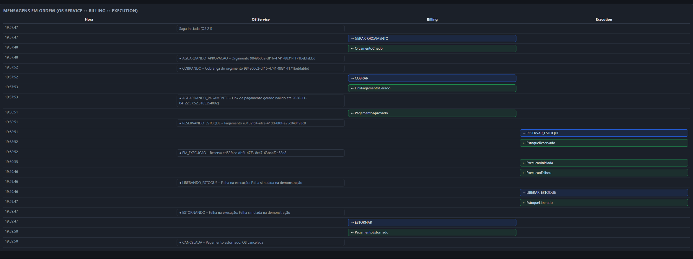
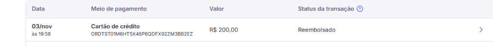
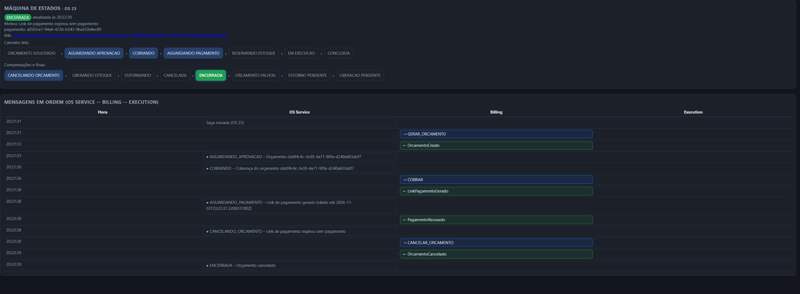
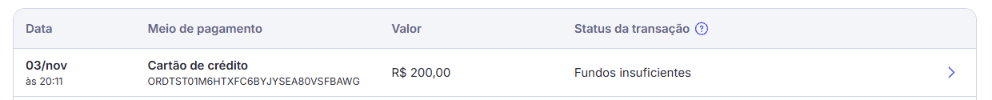

# Pagamento real com o Mercado Pago (conta de testes)

O Billing cobra por **link** (Checkout Pro): o cliente abre o link, paga na página do Mercado Pago e o Mercado Pago avisa o Billing por
**webhook**. Decisão e alternativas: [`adr/009-pagamento-por-link-checkout-pro.md`](adr/009-pagamento-por-link-checkout-pro.md).
Sem nada configurado o Billing usa o provedor **simulado** (nenhuma conta necessária).

> **Regra de ouro:** Access Token e assinatura do webhook **nunca** vão para o Git, para o chat ou para prints do vídeo. Só variável de ambiente.

## 1. Criar a aplicação e as credenciais (uma vez)

1. Entre em `https://www.mercadopago.com.br/developers` com a sua conta e abra **Suas integrações → Criar aplicação**.
   Nome sugerido: `oficina-soat`. Produto: **Checkout Pro**.
2. Em **Suas integrações → (a aplicação) → Dados da integração → Testes → Credenciais de teste**, copie o **Access Token de teste** (começa com `APP_USR`).
3. Em **Contas de teste**, crie **dois usuários de teste**: um *vendedor* e um *comprador*. Anote o e-mail e a senha do comprador (é com ele que se paga o link).
4. Em **Webhooks → Configurar notificações**, escolha o modo **Teste**, marque o evento **Pagamentos** e informe a URL do passo 2 abaixo.
   Ao salvar, o painel mostra a **assinatura secreta**: é o `MERCADOPAGO_WEBHOOK_SECRET`.

## 2. Expor o webhook (só local)

O Mercado Pago não alcança `localhost`; a URL precisa ser **HTTPS pública**. Use um túnel (qualquer um):

```powershell
ngrok http 8082        # ou: cloudflared tunnel --url http://localhost:8082
```

Copie a URL `https://xxxx...` e use `https://xxxx.../webhooks/mercadopago` no painel e em `MERCADOPAGO_NOTIFICATION_URL`.
(O endereço muda a cada execução do túnel gratuito: atualize os dois.)

## 3. Subir o Billing com o Mercado Pago

Numa janela do PowerShell **só para o Billing** (as variáveis valem só nessa janela):

```powershell
$env:PAGAMENTO_PROVEDOR            = "mercadopago"
$env:MERCADOPAGO_ACCESS_TOKEN      = Read-Host "Access Token de teste"      # cole aqui; nao aparece no historico do script
$env:MERCADOPAGO_WEBHOOK_SECRET    = Read-Host "Assinatura secreta do webhook"
$env:MERCADOPAGO_NOTIFICATION_URL  = "https://xxxx.ngrok-free.app/webhooks/mercadopago"
$env:AWS_ENDPOINT_URL              = "http://localhost:4566"
Remove-Item Env:AWS_PROFILE -ErrorAction SilentlyContinue
$env:PORT = "8082"
cd billing-service
.\mvnw.cmd spring-boot:run
```

O serviço **não sobe** sem o token e o segredo (a mensagem de erro diz qual falta). Os outros dois serviços sobem como sempre
(`scripts\local\subir-servicos.ps1`; feche a janela do Billing que ele abriu e use a sua).

## 4. Testar o fluxo

1. Crie a OS, peça o orçamento e **aprove** (`POST /api/ordens-servico/{id}/orcamento/aprovacao`; o corpo é ignorado, o provedor real sempre gera link).
2. `GET /api/ordens-servico/{id}/saga` → `estado: AGUARDANDO_PAGAMENTO` e `linkPagamento` com o endereço do Mercado Pago.
3. Abra o link **numa janela anônima**, entre com o **usuário comprador de teste** e pague com um **cartão de teste** (lista oficial no painel:
   *Suas integrações → Cartões de teste*). O nome do titular decide o resultado: `APRO` aprova, `FUND` = saldo insuficiente, `OTHE` = recusa genérica (a tentativa fica recusada no Mercado Pago, mas **o link continua aberto** e o cliente pode tentar de novo: a Saga só reage quando um pagamento é aprovado ou quando o link vence); CPF `12345678909`, validade `11/30`.
4. A Saga segue sozinha: `RESERVANDO_ESTOQUE` → `EM_EXECUCAO`, e `GET /api/orcamentos/{id}/pagamentos` (Billing) mostra o pagamento `APROVADO`.

### Se o aviso não chegar

A documentação do Mercado Pago diz que **pagamentos feitos com credenciais de teste não disparam notificações**; no teste de 03/11 o aviso chegou sozinho, mas nem sempre isso acontece. Duas saídas:

- **Simular a notificação** no painel (Webhooks → *Simular notificação*, evento *Pagamentos*, com o **id do pagamento** feito no teste); ou
- **Conciliar na mão** (o Billing consulta o pagamento no Mercado Pago e confirma, exatamente como o webhook faria):
  `POST http://localhost:8082/api/mercadopago/pagamentos/{idDoPagamentoNoMercadoPago}/sincronizar` com o JWT de ADMIN.
  O id do pagamento aparece na tela de "pagamento aprovado" e em *Suas integrações → Pagamentos de teste*.

Para demonstrar a **compensação A** sem esperar 24 h, use `PAGAMENTO_VALIDADE_LINK_MINUTOS=2` (o link vence em 2 min e o Billing publica a recusa).

## 5. O que está validado e o que não está

| Item | Situação |
|---|---|
| Regras da Saga, estados, vencimento, pagamento tardio, idempotência | cobertas por testes unitários e de banco |
| Corpo da preferência, consulta e estorno | cobertos por testes com um Mercado Pago de mentira (`MockRestServiceServer`) |
| Webhook assinado (`x-signature`, `x-request-id`, HMAC-SHA256) | **validado em 03/11/2026**: pagamento feito com o comprador de teste; o aviso chegou sozinho pelo túnel, passou na conferência da assinatura e a Saga avançou sem `/sincronizar` |
| Criação do link (`/checkout/preferences`) e consulta do pagamento (`/v1/payments/{id}`) | **validados em teste real em 02/11/2026** (conta de teste, cartão de teste, conciliação manual por `/sincronizar`): a Saga foi de `AGUARDANDO_PAGAMENTO` a `EM_EXECUCAO` |
| Estorno (`/v1/payments/{id}/refunds`) | **validado em 03/11/2026**: compensação C com o provedor real (execução falhou, estoque devolvido, `ESTORNAR` -> `PagamentoEstornado`, OS `CANCELADA`); o painel do Mercado Pago mostra o pagamento de R$ 200,00 como *Reembolsado* |
| Link vencido (compensação A) com o provedor real | **validado em 03/11/2026** com `PAGAMENTO_VALIDADE_LINK_MINUTOS=2`: o Billing publicou `PagamentoRecusado` no instante em que o link venceu (sem esperar a folga de 60 s da Saga), a Saga foi a `CANCELANDO_ORCAMENTO` e terminou em `ENCERRADA` ("Link de pagamento expirou sem pagamento") |
| Webhook na AWS | **não incluído**: o Billing não é exposto pelo API Gateway. Na AWS o provedor continua `simulado` (ou: rota pública só para `/webhooks/mercadopago`) |

Se algo divergir no primeiro teste real, os logs do Billing dizem qual chamada falhou (nunca registram o token).

## 6. Segredos no Kubernetes (se um dia for para a AWS)

```powershell
kubectl -n oficina create secret generic billing-service-secrets --from-literal=MERCADOPAGO_ACCESS_TOKEN=... `
  --from-literal=MERCADOPAGO_WEBHOOK_SECRET=... --dry-run=client -o yaml | kubectl apply -f -
```

e no `billing-service-config`: `PAGAMENTO_PROVEDOR: "mercadopago"` e `MERCADOPAGO_NOTIFICATION_URL`. (O `deploy-aws.ps1` atual não cria esses valores.)

## 7. Evidências

Imagens do teste real de 03/11/2026 (estorno e link vencido) em [`evidencias/mercado-pago/`](evidencias/mercado-pago/README.md).









